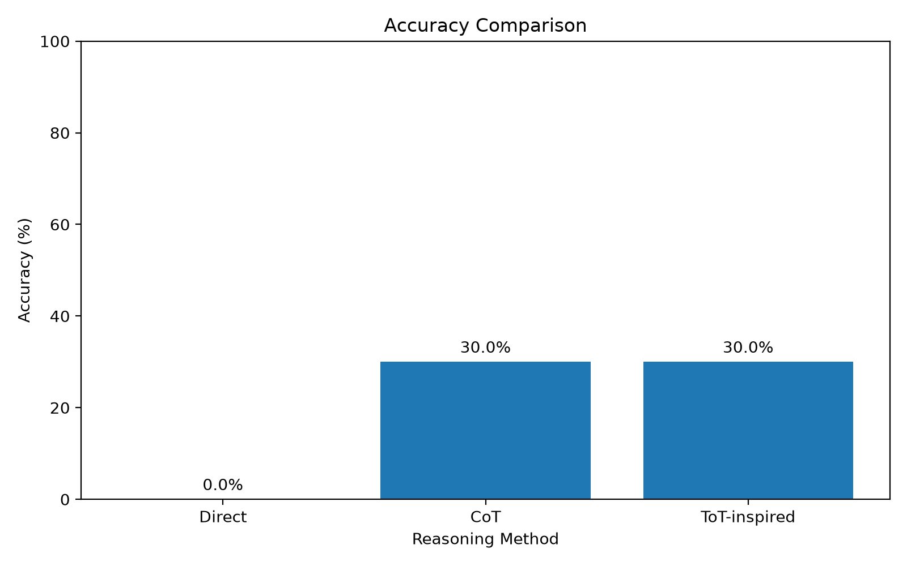

# استدلال ساختارمند در مدل‌های زبانی
## از زنجیره افکار (Chain of Thought) تا درخت افکار (Tree of Thoughts)

این مخزن شامل پیاده‌سازی و ارزیابی آزمایشی سه راهبرد برای حل مسائل ریاضی چندمرحله‌ای توسط مدل‌های زبانی بزرگ (LLMs) است. هدف پژوهش، بررسی ارتباط میان ساختار استدلال، دقت پاسخ نهایی و میزان خروجی تولیدشده توسط مدل است.

---

## 1. معرفی پژوهش

مدل‌های زبانی بزرگ می‌توانند مسائل را با روش‌های مختلفی حل کنند. در ساده‌ترین حالت، مدل مستقیماً پاسخ را تولید می‌کند. در روش زنجیره افکار، مدل تشویق می‌شود مراحل حل مسئله را به‌صورت متوالی توضیح دهد. در رویکرد الهام‌گرفته از درخت افکار، چند مسیر احتمالی برای حل مسئله تولید و سپس یکی از آن‌ها انتخاب می‌شود.

### سؤال اصلی پژوهش

تغییر ساختار استدلال مدل‌های زبانی از زنجیره افکار (CoT) به رویکردی الهام‌گرفته از درخت افکار (ToT) چه تأثیری بر دقت پاسخ‌گویی و کارایی مدل در حل مسائل چندمرحله‌ای دارد؟

### اهداف

- مقایسه دقت پاسخ نهایی در سه روش استدلالی
- بررسی تأثیر تولید مراحل استدلال بر عملکرد مدل
- بررسی نقش تولید و ارزیابی چند مسیر حل مسئله
- مقایسه میزان خروجی تولیدشده و تعداد فراخوانی‌های مدل
- بررسی محدودیت‌های ارزیابی و انتخاب پاسخ توسط خود مدل

---

## 2. روش‌های مورد بررسی

### روش اول: Direct Prompting

در این روش، مدل مستقیماً برای حل مسئله و ارائه پاسخ نهایی درخواست می‌شود. از مدل خواسته می‌شود توضیح اضافه ندهد و پاسخ را در قالب مشخصی ارائه کند.

### روش دوم: Chain of Thought (CoT)

در این روش، مدل باید مسئله را به‌صورت مرحله‌به‌مرحله حل کند. هدف، ایجاد یک مسیر استدلالی متوالی و قابل مشاهده است.

### روش سوم: ToT-inspired

در این پیاده‌سازی، مدل دو مسیر پیشنهادی مستقل برای حل مسئله تولید می‌کند. سپس همان مدل در نقش ارزیاب (Judge)، مسیرها را بررسی کرده و یکی را انتخاب می‌کند. پاسخ نهایی از مسیر انتخاب‌شده استخراج می‌شود.

**نکته مهم:** پیاده‌سازی حاضر یک روش الهام‌گرفته از Tree of Thoughts است و بازتولید کامل الگوریتم اصلی ToT محسوب نمی‌شود. در این آزمایش از جست‌وجوی کامل درخت، توسعه چندسطحی گره‌ها و الگوریتم‌های پیشرفته هرس استفاده نشده است.

---

## 3. تنظیمات آزمایش

| مؤلفه | مقدار |
|---|---|
| مدل زبانی | Qwen/Qwen2.5-0.5B-Instruct |
| منبع داده | openai/gsm8k |
| پیکربندی داده | main |
| بخش داده | test |
| تعداد مسائل | 10 |
| Seed نمونه‌گیری | 42 |
| تعداد مسیرهای پیشنهادی در ToT | 2 |
| حداکثر توکن جدید در هر فراخوانی اصلی | 256 |
| محیط اجرا | Google Colab / GitHub Codespaces |
| چارچوب اجرا | Python, PyTorch, Transformers |

هر سه روش روی مجموعه یکسانی از مسائل ارزیابی شده‌اند. نمونه‌ها با Seed ثابت انتخاب شده‌اند تا انتخاب داده‌ها قابل تکرار باشد.

در روش‌های Direct و CoT، تولید پاسخ به‌صورت قطعی انجام شده است. تولید مسیرهای پیشنهادی در روش ToT-inspired با نمونه‌گیری انجام می‌شود.

---

## 4. معیارهای ارزیابی

### 4.1 دقت پاسخ نهایی (Accuracy)

پاسخ استخراج‌شده مدل با پاسخ صحیح مجموعه GSM8K مقایسه می‌شود. دقت از تقسیم تعداد پاسخ‌های صحیح بر تعداد کل مسائل محاسبه می‌شود.

### 4.2 تعداد توکن‌های تولیدشده (Generated Tokens)

میانگین تعداد توکن‌های خروجی مدل برای هر مسئله اندازه‌گیری می‌شود. این معیار برای مقایسه حجم خروجی تولیدشده به کار می‌رود و اندازه‌گیری مستقیم هزینه مالی، زمان محاسباتی یا مصرف انرژی نیست.

### 4.3 تعداد فراخوانی مدل (Generation Calls)

تعداد دفعاتی که مدل برای تولید پاسخ یا ارزیابی مسیرها فراخوانی می‌شود، ثبت می‌گردد.

در تنظیم فعلی:
- Direct: یک فراخوانی
- CoT: یک فراخوانی
- ToT-inspired: دو فراخوانی برای تولید مسیرها و یک فراخوانی برای داوری؛ در مجموع سه فراخوانی

### 4.4 استخراج پاسخ

پاسخ صحیح مسائل GSM8K از بخش مشخص‌شده با `####` استخراج می‌شود. پاسخ مدل فقط زمانی قابل استخراج است که در خروجی آن عبارت `Final answer:` وجود داشته باشد.

پاسخ‌هایی که قابل استخراج نباشند، در محاسبه دقت به‌عنوان پاسخ نادرست محسوب می‌شوند. برنامه از حدس زدن پاسخ با استفاده از اعداد پراکنده در متن استدلال خودداری می‌کند.

---

## 5. نمونه‌ای از کد اصلی

بخش زیر نمونه‌ای از منطق استخراج پاسخ و اعتبارسنجی انتخاب داور در فایل `src/experiment.py` است.

```python
import re

FINAL_RE = re.compile(
    r"Final\\s+answer\\s*:\\s*([^\\n\\r]+)",
    re.IGNORECASE
)

JUDGE_RE = re.compile(
    r"Best\\s+candidate\\s*:\\s*(\\d+)",
    re.IGNORECASE
)

def model_answer(output):
    # Only accept an explicitly marked final answer.
    matches = FINAL_RE.findall(output)

    if not matches:
        return None

    return normalize_number(matches[-1])


def choose_candidate(judge_output, n_candidates):
    # Require the exact expected judge response format.
    match = JUDGE_RE.fullmatch(judge_output.strip())

    if not match:
        return None

    selected = int(match.group(1))

    if 1 <= selected <= n_candidates:
        return selected

    return None
```

در روش ToT-inspired، مسیرها به‌صورت جداگانه تولید می‌شوند و سپس برای ارزیابی به مدل ارسال می‌شوند:

```python
candidate_texts = []

for _ in range(num_candidates):
    candidate, token_count = generate(
        tokenizer,
        model,
        candidate_prompt,
        max_new_tokens,
        sample=True
    )
    candidate_texts.append(candidate)

judge_output, judge_tokens = generate(
    tokenizer,
    model,
    judge_prompt,
    max_new_tokens,
    sample=False
)

selected = choose_candidate(
    judge_output,
    len(candidate_texts)
)
```

این کد صرفاً نمونه‌ای از منطق اصلی است؛ نسخه کامل پیاده‌سازی در فایل `src/experiment.py` قرار دارد.

---

## 6. نتایج آزمایش اصلی

نتایج زیر مربوط به اجرای 10 مسئله از مجموعه آزمون GSM8K است.

| معیار | Direct | CoT | ToT-inspired |
|---|---:|---:|---:|
| تعداد پاسخ صحیح | 0 از 10 | 3 از 10 | 3 از 10 |
| دقت | 0% | 30% | 30% |
| پاسخ قابل استخراج | 9 | 4 | 4 |
| میانگین توکن خروجی | 44.7 | 204.4 | 407.2 |
| میانگین فراخوانی مدل | 1 | 1 | 3 |
| خطای قالب داوری | 0 | 0 | 4 |

### نمودار مقایسه دقت



### فایل‌های نتایج

- [گزارش جزئیات هر سؤال و خروجی مدل‌ها](results/question_report.md)
- [جدول کامل نتایج آزمایش](results/summary.csv)
- [داده خام خروجی مدل‌ها](results/experiment_results.jsonl)
- [تنظیمات اجرای آزمایش](results/run_config.json)

---

## 7. تحلیل نتایج

در این اجرای آزمایشی، روش Direct هیچ پاسخ صحیحی از 10 مسئله تولید نکرد. روش CoT به دقت 30 درصد رسید. روش ToT-inspired نیز دقت 30 درصد را ثبت کرد.

بنابراین، در نمونه بررسی‌شده، تولید و ارزیابی چند مسیر پیشنهادی نسبت به CoT بهبود قابل مشاهده‌ای در دقت نهایی ایجاد نکرده است.

از نظر حجم خروجی، میانگین توکن‌های تولیدشده در روش ToT-inspired برابر 407.2 بوده است؛ در حالی که این مقدار برای CoT برابر 204.4 است. همچنین روش ToT-inspired به‌طور متوسط سه فراخوانی مدل برای هر مسئله نیاز داشته است.

در چهار مورد از ده مسئله، خروجی داور با قالب مورد انتظار برنامه مطابقت نداشته است. این موارد به‌عنوان خطای داوری ثبت شده‌اند و در صورت انتخاب نشدن مسیر معتبر، پاسخ نهایی قابل استخراج نبوده است.

### جمع‌بندی نتایج

در این آزمایش کوچک، CoT و ToT-inspired دقت یکسانی داشته‌اند، اما روش ToT-inspired خروجی بیشتری تولید کرده و به فراخوانی‌های بیشتری نیاز داشته است.

این مشاهده نشان می‌دهد افزایش پیچیدگی ساختار استدلال لزوماً به افزایش دقت منجر نمی‌شود؛ دست‌کم در تنظیمات و نمونه بررسی‌شده در این پروژه.

---

## 8. محدودیت‌های پژوهش

نتایج باید با توجه به محدودیت‌های زیر تفسیر شوند:

1. تعداد مسائل آزمایش فقط 10 مورد است و برای نتیجه‌گیری آماری قوی کافی نیست.
2. مدل استفاده‌شده Qwen2.5-0.5B-Instruct است و نتایج را نمی‌توان به همه مدل‌های زبانی تعمیم داد.
3. روش ToT پیاده‌سازی‌شده نسخه کامل الگوریتم اصلی نیست.
4. تولیدکننده مسیرها و داور از یک مدل استفاده می‌کنند؛ بنابراین احتمال سوگیری در ارزیابی خود مدل وجود دارد.
5. تعداد توکن‌های خروجی فقط یک شاخص تقریبی از حجم تولید است و هزینه محاسباتی کامل را اندازه‌گیری نمی‌کند.
6. دقت پاسخ نهایی معیار اصلی است و صحت واقعی تمام مراحل استدلال به‌صورت مستقل ارزیابی نشده است.
7. خروجی قابل مشاهده مدل لزوماً بیانگر فرایند محاسباتی درونی آن نیست.

بنابراین، نتایج این پروژه باید به‌عنوان یک مقایسه آزمایشی محدود در نظر گرفته شوند، نه اثبات برتری یا ضعف عمومی یک روش.

---

## 9. ساختار مخزن

```text
structured-reasoning-llm/
│
├── prompts/
│   ├── direct_prompt.txt
│   ├── cot_prompt.txt
│   ├── tot_candidates_prompt.txt
│   └── tot_judge_prompt.txt
│
├── src/
│   ├── experiment.py
│   └── make_report.py
│
├── results/
│   ├── experiment_results.jsonl
│   ├── summary.csv
│   ├── run_config.json
│   ├── accuracy_comparison.png
│   └── question_report.md
│
├── notebooks/
│   └── colab_interactive_experiment.ipynb
│
├── requirements.txt
├── CODESPACES.md
└── README.md
```

### توضیح فایل‌ها

- `experiment.py`: اجرای سه روش، تولید پاسخ‌ها، استخراج جواب نهایی و ثبت معیارها.
- `make_report.py`: ساخت نمودار مقایسه دقت و گزارش سؤال‌به‌سؤال از روی نتایج ذخیره‌شده.
- فایل‌های پوشه `prompts`: دستورهای ورودی مورد استفاده برای هر روش.
- `experiment_results.jsonl`: خروجی خام مدل‌ها و اطلاعات هر مسئله.
- `summary.csv`: خلاصه عددی عملکرد روش‌ها.
- `run_config.json`: تنظیمات و اطلاعات اجرای آزمایش.
- `accuracy_comparison.png`: نمودار نهایی مقایسه دقت.
- `question_report.md`: گزارش تفصیلی نتایج هر مسئله.
- `notebooks/colab_interactive_experiment.ipynb`: نوت‌بوک تعاملی برای اجرای آزمایش، نمایش نمودارها و دریافت خروجی‌ها در Google Colab.

---

## 10. نحوه اجرای پروژه

Python 3.10 یا نسخه‌های جدیدتر توصیه می‌شود. اجرای مدل به حافظه و توان پردازشی وابسته است. برای اجرای تعاملی، می‌توانید نوت‌بوک [Google Colab](notebooks/colab_interactive_experiment.ipynb) را باز کنید و در صورت دسترسی، GPU را فعال کنید. اجرای محلی نیز با دستورهای زیر امکان‌پذیر است.

نصب وابستگی‌ها:

```bash
pip install -r requirements.txt
pip install matplotlib
```

اجرای آزمایش:

```bash
python src/experiment.py \
  --sample-size 10 \
  --seed 42 \
  --num-candidates 2 \
  --max-new-tokens 256
```

ساخت نمودار و گزارش:

```bash
python src/make_report.py
```

فایل‌های خروجی در پوشه `results/` ذخیره می‌شوند.

---

## 11. منابع و مبانی نظری

این پروژه بر مبنای مفاهیم و پژوهش‌های مرتبط با استدلال در مدل‌های زبانی شکل گرفته است. منابع مورد مطالعه شامل موارد زیر هستند:

- Wei et al. — Chain-of-Thought Prompting Elicits Reasoning in Large Language Models.
- Yao et al. — Tree of Thoughts: Deliberate Problem Solving with Large Language Models.
- Yao et al. — ReAct: Synergizing Reasoning and Acting in Language Models.
- Wang et al. — Self-Consistency Improves Chain of Thought Reasoning in Language Models.
- Kojima et al. — Large Language Models are Zero-Shot Reasoners.
- Attention Is All You Need — Vaswani et al.

---

## 12. وضعیت پروژه

- [x] انتخاب مسئله پژوهش و روش‌های مقایسه
- [x] آماده‌سازی پرامپت‌های سه روش
- [x] پیاده‌سازی آزمایش
- [x] اجرای آزمایش اصلی روی 10 مسئله
- [x] ثبت نتایج خام و خلاصه
- [x] تولید نمودار مقایسه دقت
- [x] تولید گزارش سؤال‌به‌سؤال
- [x] تحلیل اولیه نتایج
- [ ] تکمیل و آماده‌سازی ارائه نهایی

---

**نام پروژه:** Structured Reasoning in Language Models: From Chain of Thought to Tree of Thoughts

**مدل:** Qwen2.5-0.5B-Instruct

**داده:** GSM8K Test Split

**تعداد مسائل ارزیابی‌شده:** 10
